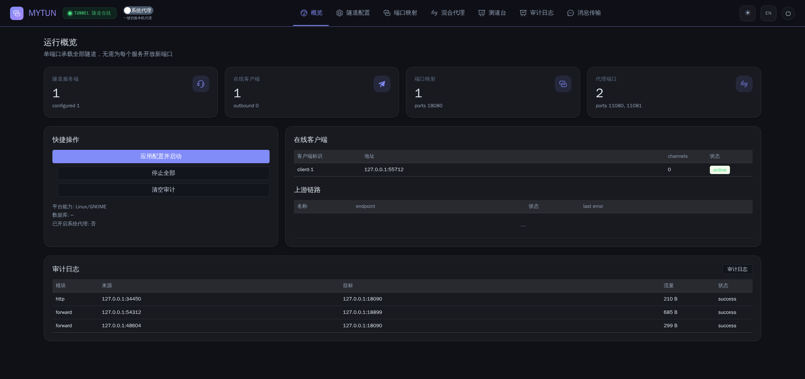
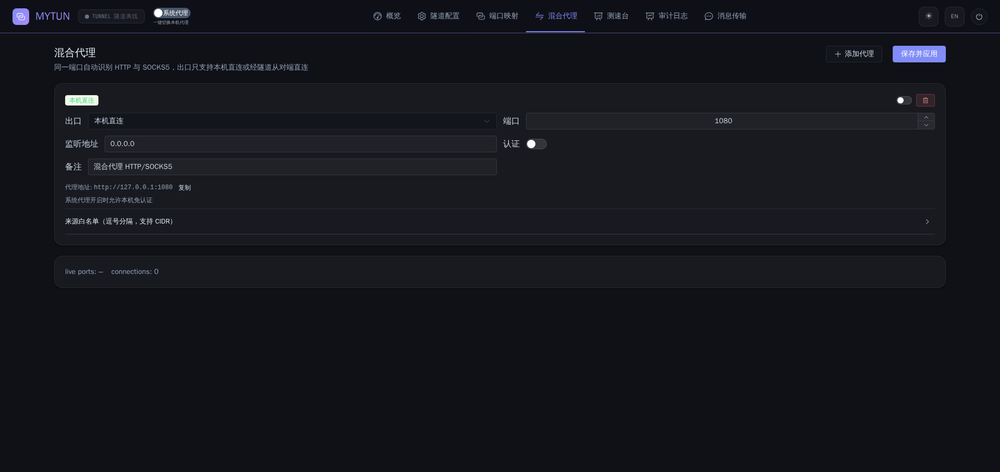

# MyTun · 单端口多隧道 + 混合代理

> 基于 [Bi-Tunnel](https://github.com/LECYWZA/Bi-Tunnel) `dev-0910` 的思路**重写**：语言换成 Go，
> 只保留「**创建代理**」与「**单端口多隧道**」两件事，其余（代理池、代理链、分流规则、软路由、
> TUN 虚拟网卡、内置 Xray 内核）全部删除。

[](LICENSE)





---

## 这是什么

一句话：**一台公网机器只开 1 个端口，就能把无数个内网服务串出来；同一个程序还能开一个 HTTP/SOCKS5
混合代理，让流量从本机或从隧道对端出去。**

- 服务端只监听 **1 个 TLS 隧道端口**，隧道之上可挂任意数量的映射与代理；
- 客户端连上后，两端**互为通路**（A 能访问 B 的端口，B 也能访问 A 的端口）；
- 混合代理同一端口自动识别 HTTP / SOCKS5，出口只有两种：**本机直连**或**经隧道从对端直连**；
- 全平台单文件二进制，配置与控制台走 Web，数据落在本地 SQLite。

### 与原版 dev-0910 的差异

| 能力 | Bi-Tunnel dev-0910 | MyTun |
|---|---|---|
| 语言 / 运行时 | Node.js + pkg 打包（约 90MB，含 Xray） | **Go 静态单文件（约 20MB，无运行时依赖）** |
| 单端口多隧道 | ✅ | ✅ 保留并重写 |
| 混合 HTTP/SOCKS5 代理 | ✅ | ✅ 保留（出口简化为 local / remote） |
| 代理池（VMess/VLESS/Trojan/SS） | ✅ 依赖 Xray 内核 | ❌ 删除（不再内置 80MB Xray 与 geo 数据） |
| 代理链 / 分流规则 | ✅ | ❌ 删除 |
| 软路由 / DHCP / MAC 过滤 | ✅ | ❌ 删除 |
| TUN 虚拟网卡 | ✅ | ❌ 删除 |
| 系统代理开关 | ✅ | ✅ 保留，且做了**崩溃残留自愈**（见下） |
| 动态分流 / 防拥塞 | ❌ | ✅ **新增**：按通道分类的公平调度与限速（见「流量公平调度」） |
| 消息 / 文件传输 | ✅ | ✅ 保留 |
| 存储 | config.json | **SQLite**（`mytun.db`，WAL） |
| 隧道协议 | 自定义 Mux v1（AES-256-GCM 逐帧） | **协议 v1 兼容**（旧客户端可连新服务端），并加了心跳与扩展帧 |

> 说明：删掉代理池后，「创建代理」只剩**开一个混合代理端口**这一件事；需要 VMess/VLESS 等
> 上游协议时，建议在本机叠加 Clash/mihomo 之类工具，MyTun 不重复造轮子。

---

## 功能

### 1. 单端口多隧道（端口映射）

```
公网服务器 (MyTun server)                       内网电脑 (MyTun client)
┌──────────────────────────┐                  ┌──────────────────────────┐
│ :33891  TLS + Mux 隧道端口│◄──── 1 条连接 ───►│ 连接服务端，自动重连      │
│   ├─ :18080 ─┐           │                  │                          │
│   ├─ :18081 ─┤ 虚拟通道   │                  │  ┌─ 127.0.0.1:80         │
│   └─ :18082 ─┘           │                  │  ├─ 127.0.0.1:3306       │
└──────────────────────────┘                  └──┴─ 192.168.1.10:8080     │
```

- 一个隧道端口承载全部映射，外网只暴露你需要的那几个端口；
- 映射的监听端可以放在 server 侧，也可以放在 client 侧（反向映射），支持双向通车；
- 每条映射独立启停、独立统计（上下行字节、耗时、成功/失败）。

### 2. 混合代理（HTTP + SOCKS5 自动嗅探）

- 同一端口先看到首字节 `0x05` 就走 SOCKS5，否则按 HTTP 代理处理（含 `CONNECT` 与绝对 URI 请求）；
- 出口 `local`：本机直接 dial 目标；出口 `remote`：通过隧道让对端 dial 目标后回传；
- 支持来源 IP 白名单/黑名单（CIDR）、HTTP Basic / SOCKS5 用户名密码认证；
- 开启系统代理时，本机回环客户端可免认证（避免本机应用被弹认证框）。

### 3. 系统代理（安全模式）

原版最大的坑是「进程被强杀 → 系统代理没恢复 → 整台机器上不了网」。MyTun 的处理：

1. 开启前把原始代理设置**备份到磁盘**（`sysproxy-backup.json`）；
2. 关闭时按备份**精确还原**，而不是简单置 0；
3. 正常退出（Ctrl+C / SIGTERM）会自动还原；
4. 下次启动如果检测到「代理指向 MyTun 但没有备份」的残留，控制台顶部会给出**一键清理**。

> Windows 写 WinINET 注册表并刷新 `DefaultConnectionSettings`；Linux 走 GNOME `gsettings`；
> macOS 走 `networksetup`。无桌面会话的 Linux（含 Android）会显示「不支持」而不是报错。

### 4. 控制台

- 概览（隧道/客户端/映射/代理实时状态）、隧道配置、端口映射、混合代理、测速台、审计日志、消息传输；
- Vue 3 + Element Plus，深色/浅色主题、中英双语，沿用原版视觉；
- 审计日志落到 SQLite，支持按模块/状态/目标过滤，并可通过 WebSocket 实时推送。

### 5. 消息与文件传输

通过隧道直接发送文本与文件，不经过任何第三方服务器；接收目录在数据目录 `files/` 下。

---

## 平台支持

| 平台 | 状态 | 产物 |
|---|---|---|
| Windows x64 | ✅ 已验证 | `mytun-windows-amd64.exe` |
| Linux x64 / arm64 | ✅ 已验证 | `mytun-linux-amd64` / `mytun-linux-arm64` |
| Android arm64 / armv7 | ✅ 可构建（`dist/mytun-android.apk`） | APK（内置核心 + WebView 控制台 + 前台服务） |
| macOS | ⚙️ 可编译未实测 | `mytun-darwin-*` |
| iOS | ⏳ 未验证（无 Mac 环境） | 可用 GitHub Actions 的 macOS runner 构建 |

Android 端说明：APK 内嵌的是**同一份 Go 静态二进制**（放在 assets，首次启动复制到私有目录并赋可执行位），
由前台服务拉起，UI 用 WebView 加载本地控制台。因此**不占用系统 VPN 槽位**，可与其它 VPN
（公司内网、第三方代理）共存。

---

## 快速开始

### 方式一：源码运行

```bash
# 需要 Go 1.24+
git clone https://github.com/LECYWZA/MyTun.git
cd MyTun
cd webui && npm install && npm run build && cd ..
go build -o mytun ./cmd/mytun
./mytun --port 8899
# 浏览器打开 http://127.0.0.1:8899 ，默认账号 admin / password（首次登录后请改）
```

### 方式二：Docker

```bash
docker compose -f deploy/docker-compose.yml up -d --build
# 必须使用 host 网络，否则动态创建的映射/代理端口无法暴露
```

### 方式三：预编译产物

从 Release 下载对应平台的单文件，直接运行（Windows 双击或 `mytun.exe`，Linux `chmod +x` 后执行）。

### 三步跑通一次隧道

1. 公网机：控制台 → **隧道配置** → 记下「隧道端口」与「连接密码」→ 保存并应用；
2. 内网机：控制台 → **隧道配置 → 客户端** → 填公网 IP、隧道端口、同一密码 → 启用；
3. 公网机：**端口映射** → 新增「对外 18080 → 目标 127.0.0.1:80」→ 保存并应用；
   浏览器访问 `http://公网IP:18080` 即可到达内网机的 80 端口。

想做「经隧道出网」的代理：**混合代理** → 出口选「经隧道（对端出网）」→ 选中在线客户端 → 启用，
然后把浏览器/系统的代理指向 `http://127.0.0.1:<该端口>`。

---

## 架构

```
cmd/mytun            入口：命令行、优雅退出、系统代理还原
internal/mux         帧协议（v1 兼容）、通道、流控、心跳
internal/tunnel      TLS 服务端/客户端、认证、会话与重连
internal/forward     端口映射（server/client 两侧对称实现）
internal/proxy       混合 HTTP/SOCKS5 代理、ACL、local/remote 出口
internal/runtime     生命周期编排：配置 → 监听器 → 会话注册表
internal/store       SQLite 配置与审计（modernc.org/sqlite，纯 Go，无需 CGO）
internal/qos         按通道的动态限速与公平调度（分类、令牌桶、保底与上限）
internal/web         控制台 API / WebSocket / 内嵌前端
internal/sysproxy    系统代理（Windows 注册表 / GNOME / networksetup）+ 备份还原
android/             原生 WebView 壳（前台服务拉起内置核心）
webui/               Vue 3 + Element Plus 前端
```

### 隧道协议

与 Bi-Tunnel dev-0910 的帧格式保持一致，便于新旧程序混跑对照：

```
[1 字节类型][4 字节通道 ID][4 字节负载长度][负载]

类型: 1 DATA  2 CREATE  3 CLOSE  4 AUTH  5 AUTH_RES  6 CREATE_ACK
扩展: 7 PING  8 PONG    9 HELLO（协议协商，旧端会忽略）
负载: AES-256-GCM，密钥 = sha256(隧道密码)，每帧独立随机 nonce
```

CREATE 帧的元数据是 JSON（`{"type":"forward","host":"127.0.0.1","port":80}`），接收方 dial 成功后
回 `CREATE_ACK`，失败回 `0`，发送方据此快速失败而不是干等超时。

---

## 流量公平调度（防拥塞）

一条隧道被多个通道共享时，单个大流量会把队列塞满，另一个通道的网页就打不开了。MyTun 内置了
按通道的动态限速与分类调度，控制台「隧道配置 → 流量调度」一键开关：

- **自动分类**：持续大流量被判为 `bulk`；小包、低占空比、突发的被判为 `interactive`。分类带滞回
  （升 0.30 / 降 0.10 两个阈值 + 连续 tick 确认），已被限速的流不会来回抖动。
- **保底与上限**：`interactive` 流共享设定的保底比例并享有单流保底速率；`bulk` 流按 max-min 公平
  分享剩余带宽，每条都有下限防止饿死。
- **容量来源**：`按上限限速` 用你填写的总带宽做硬顶；`自动估计` 用观测峰值（EWMA，快升慢降）估算。
- **立即生效**：固定带宽模式下新通道从第一字节就带上限，短传输不会因为赶在控制周期之前而全速冲过去。
- **背压而非丢包**：限速发生在隧道写入侧，通过 TCP 流控把压力传回生产端，不丢数据、不破坏协议。

实测（20 Mbps 限速隧道，2 个下载 + 3 个浏览客户端并发 12 秒）：

| 交互保底比例 | 下载总吞吐 | 浏览请求数 | 浏览 p50 延迟 |
|---|---|---|---|
| 25% | 10.65 Mbps | 504 | **21 ms** |
| 5% | 5.32 Mbps | 504 | 21 ms |

限速精度实测：配置 100 Mbps 时下载速率 12.45 MB/s（= 99.6 Mbps），关闭后回到 297 MB/s。

---

## 性能（实测）

环境：OpenWrt 容器 / Intel N5105（4 核，弱 CPU）/ loopback，64MB 传输，客户端 curl。
loopback 下直连基线约 1.2–1.5 GB/s（纯内存拷贝），因此下列数字反映的是**加密与转发的真实开销**。

| 路径 | 吞吐 | 说明 |
|---|---|---|
| 直连 127.0.0.1:18090（基线） | 1.22–1.56 GB/s | 仅内核拷贝，不代表网络 |
| 端口映射（18080 → 隧道 → 18090） | **300–343 MB/s** | TLS + AES-256-GCM + 多路复用全链路 |
| 混合代理 出口=经隧道（HTTP） | **280–315 MB/s**，连续 5 次无停滞 | 含隧道与目标 dial |
| 混合代理 出口=经隧道（SOCKS5） | **240–304 MB/s** | 同上 |
| 混合代理 出口=本机直连 | 1.21–1.43 GB/s | 无隧道，仅代理逻辑 |

- 单进程常驻内存约 **23–25 MB**（含 SQLite、Web 控制台、活跃会话）。
- 50 并发隧道请求：50/50 成功，p50 12.9 ms；50 并发代理请求：50/50 成功，p50 15.3 ms（并发客户端为 Python，QPS 受客户端限制而非服务端）。
- 300 MB/s 已超过千兆网（125 MB/s）与 2.5G 网（312 MB/s）的线速，在真实链路上不会成为瓶颈；
  需要更高吞吐时可多开客户端 ID 分摊到多条 TLS 连接。

容器化部署同样已验证（宿主 Docker 24.0.7，`deploy/test-e2e.sh` 一键跑 A/B 双容器）：

| 路径 | 吞吐 |
|---|---|
| 端口映射（容器 → 隧道 → 容器） | **298–313 MB/s** |
| 混合代理 出口=经隧道 | **281–315 MB/s** |
| 混合代理 出口=本机直连 | **1.30–1.47 GB/s** |
| 常驻内存 | A 21.9 MiB / B 10.5 MiB |


---

## 构建

```bash
# 前端（产物会写进 internal/web/static 供 go:embed 使用）
cd webui && npm install --registry=https://registry.npmmirror.com && npm run build && cd ..

# 三平台二进制
CGO_ENABLED=0 GOOS=windows GOARCH=amd64 go build -ldflags "-s -w" -o dist/mytun-windows-amd64.exe ./cmd/mytun
CGO_ENABLED=0 GOOS=linux   GOARCH=amd64 go build -ldflags "-s -w" -o dist/mytun-linux-amd64 ./cmd/mytun
CGO_ENABLED=0 GOOS=linux   GOARCH=arm64 go build -ldflags "-s -w" -o dist/mytun-linux-arm64 ./cmd/mytun

# Android APK（需要 Android SDK 34/35 + JDK 17；脚本会先交叉编译内置核心）
bash scripts/build-apk.sh
```

---

## 命令行

```
mytun [选项]
  --port <端口>      Web 控制台端口（默认 8899）
  --host <地址>      Web 控制台监听地址（默认 0.0.0.0）
  --data <目录>      数据目录（配置与 SQLite）
  --no-autostart     启动时不自动拉起已启用的组件
  --init-only        仅初始化数据库后退出
  --version          显示版本
```

首次运行会在数据目录生成 `mytun.db`，并自动创建一条默认服务端配置（随机密码，启动横幅里会打印）。

---

## 安全

- 隧道传输用自签 TLS（`crypto/tls`，TLS 1.2+），客户端默认跳过证书校验（与原版一致，靠密码认证）；
- 认证用**恒定时间比较**，避免时序侧信道；
- 控制台默认 `admin` / `password`，**请首次登录后立即修改**（设置页可改）；
- 控制台可用 Basic Auth / Cookie 登录，WebSocket 支持 `?token=`；
- 每通道缓冲上限 2 MiB，超限断链，防止慢连接吃光内存。

---

## 已知限制

- iOS 未实机验证（需要 macOS 工具链）；
- 代理不支持上游协议（VMess/VLESS/Trojan），需要时请与本机 Clash 组合使用；
- 一个控制台里服务端可多条、客户端可多条，但「同端口映射被占用」会明确报错而不是静默失败；
- 极端并发下单个慢通道会占用其自身缓冲，不会阻塞其他通道（每通道独立队列），但总吞吐仍受单条
  TLS 连接限制——需要更大吞吐时建议多开客户端 ID。

---

## License

MIT。原项目 Bi-Tunnel 亦为 MIT，感谢原作者的设计与前端。
